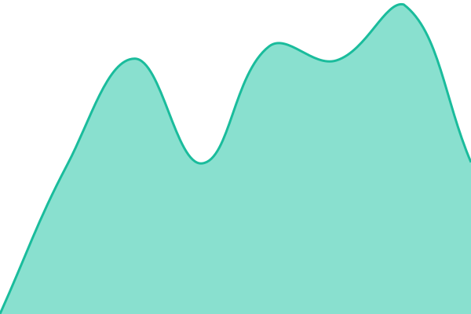
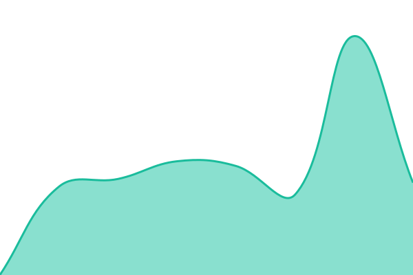
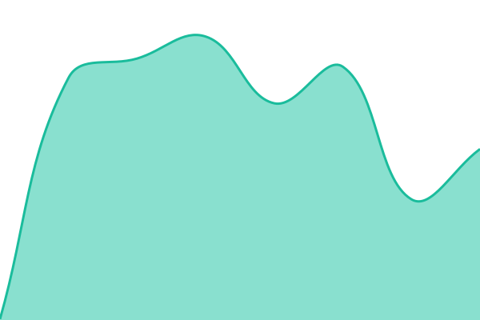

# [📈 Live Status](https://status.adoromassagem.com): <!--live status--> **Tudo funcionando normalmente**

This repository contains the open-source uptime monitor and status page for [novakads](https://status.adoromassagem.com), powered by [Upptime](https://github.com/upptime/upptime).

With [Upptime](https://upptime.js.org), you can get your own unlimited and free uptime monitor and status page, powered entirely by a GitHub repository. We use [Issues](https://github.com/novakads/adoromassagem-status/issues) as incident reports, [Actions](https://github.com/novakads/adoromassagem-status/actions) as uptime monitors, and [Pages](https://status.adoromassagem.com) for the status page.

<!--start: status pages-->
<!-- This summary is generated by Upptime (https://github.com/upptime/upptime) -->
<!-- Do not edit this manually, your changes will be overwritten -->
<!-- prettier-ignore -->
| URL | Status | History | Response Time | Uptime |
| --- | ------ | ------- | ------------- | ------ |
|  [Site](https://adoromassagem.com) | No ar | [site.yml](https://github.com/novakads/adoromassagem-status/commits/HEAD/history/site.yml) | 

 1289ms
     
 | 

<a href="https://status.adoromassagem.com/history/site">100.00%</a>
    

|  [Busca de profissionais](https://adoromassagem.com/salvador/relaxante) | No ar | [busca-de-profissionais.yml](https://github.com/novakads/adoromassagem-status/commits/HEAD/history/busca-de-profissionais.yml) | 

 400ms
     
 | 

<a href="https://status.adoromassagem.com/history/busca-de-profissionais">100.00%</a>
    

|  [Entrar na conta](https://adoromassagem.com/entrar) | No ar | [entrar-na-conta.yml](https://github.com/novakads/adoromassagem-status/commits/HEAD/history/entrar-na-conta.yml) | 

 254ms
     
 | 

<a href="https://status.adoromassagem.com/history/entrar-na-conta">100.00%</a>
    

<!--end: status pages-->

[**Visit our status website →**](https://status.adoromassagem.com)

## 📄 License

- Powered by: [Upptime](https://github.com/upptime/upptime)
- Code: [MIT](./LICENSE) © [Anand Chowdhary](https://anandchowdhary.com)
- Data in the `./history` directory: [Open Database License](https://opendatacommons.org/licenses/odbl/1-0/)
